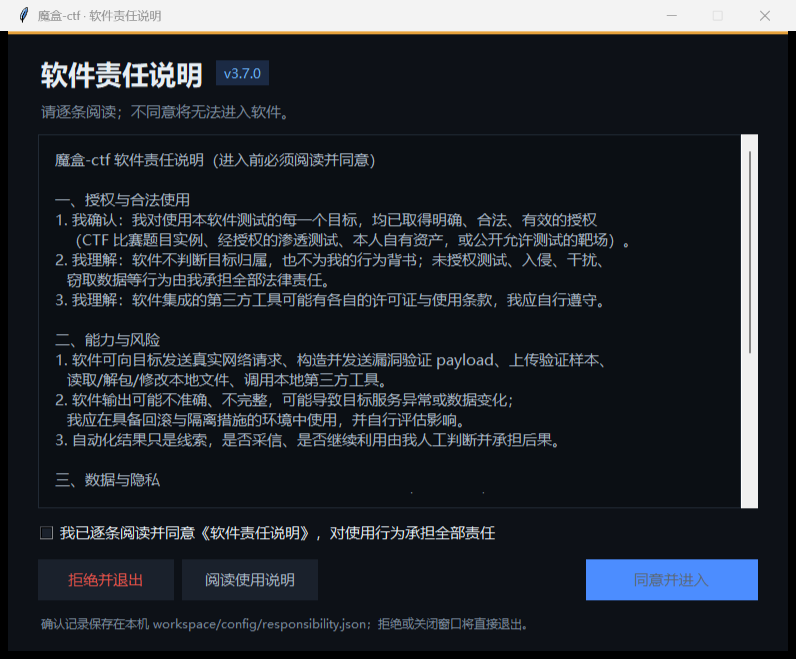
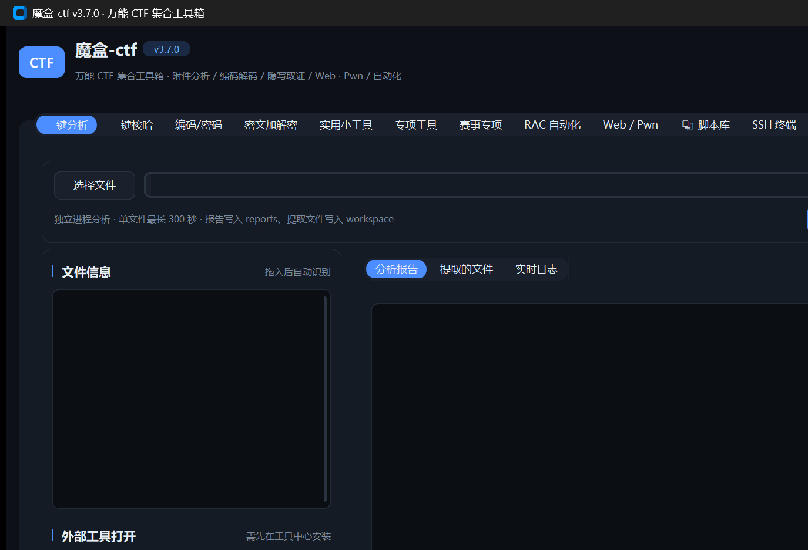

# 魔盒-CTF 交付与验证（v3.7.0 记录）

> **本文是 v3.7.0 当时的交付记录，截图与版本号均为那时状态，请勿当作当前版本依据。**
> 当前版本 `4.1.0`（PE `4.1.0.0`）的变更与验证结果见 `CHANGELOG.md` 顶部与 `不足与bug记录.md`。

- 版本：`3.7.0` / PE `3.7.0.0`
- 日期：2026-11-08
- 性质：本机离线分析 + 本地回环靶站 + 授权靶场实测；未执行附件样本代码，加固/回滚脚本与检测用例只生成不执行。

## 一、交付清单

| 类别 | 内容 |
|---|---|
| 核心包 | `ctfbox/`：dispatcher、identifier、各 `modules_*`、`ui_*`、`toolsmgr`、`web*` |
| 一键梭哈 | `ctfbox/autopilot/`：triage、orchestrator、workspace、scope、sandbox、audit、wp、`exploit/`、`tools/` |
| 赛事专项 | `ctfbox/competition/`：memory、traffic、mobile、codeaudit、baseline、logtime、defense、util、cli |
| 平台闭环 | `ctfbox/platforms/`：CTFd / PolarCTF 登录、题目、实例与提交 |
| 责任闸门 | `ctfbox/responsibility.py`、`ctfbox/ui_consent.py` |
| RAC | `ctfbox/rac/`：识别、装配、执行、侦察、远程执行、Oracle 巡检、RPA |
| 脚本库 | `scripts/library/`：88 个脚本与速查表（69 个 Python 脚本） |
| 测试 | `tests/`：全量 110 项，含本地 Web 靶站、责任闸门、判型、AI 裁判、赛事专项、平台与 RAC |
| 文档 | `README.md`、`使用说明.md`、`BUILD说明.md`、`CHANGELOG.md`、`不足与bug记录.md`、`docs/架构.md`、本文 |
| 成品 | `CTFToolbox.exe` / `魔盒-CTF.exe`（PyInstaller onedir，PE 3.7.0.0） |

## 二、责任闸门验证

| 用例 | 预期 | 结果 |
|---|---|---|
| GUI 启动 | 先显示《软件责任说明》，未勾选时「同意并进入」禁用 | 通过 |
| GUI 拒绝 / 关闭窗口 | 进程退出，不进入主界面 | 通过 |
| CLI 未同意直接运行 | 打印责任说明并退出 2 | 通过 |
| CLI `--accept-responsibility` | 退出 0，写入 `workspace/config/responsibility.json` | 通过 |
| 说明版本变化 | 旧确认自动失效，需重新确认 | 通过 |
| 撤销确认 | `revoke` 后恢复拦截 | 通过 |
| 兼容参数 | `--ctf-only`、`--i-own-this-target`、`--consent` 可传入且不改变行为 | 通过 |

启动责任说明窗与主界面截图：





## 三、自动化回归

命令：

```
D:\PY\python.exe -m unittest discover -s tests -v
```

结果：**Ran 110 tests — OK**（约 101 秒）。

覆盖重点：

- 责任闸门：CLI 拦截、确认落盘、版本失效、撤销、条款关键字；
- 首层判型：文件类型/特征评分、Web 证据评分、阶段选择与跳过记录；
- AutoPilot 文件链：编码套娃、XOR、哈希、PE/ELF 静态、Ghidra、对称密码、RSA/ECC、加密 ZIP、图片/音频隐写；
- AutoPilot Web 链：指纹、SPA 渲染、登录门槛、只读探测、SQLi/命令注入/上传/包含/XSS/JWT/IDOR 与审计；
- 赛事专项：八个子命令的路由与模块行为；
- 平台：CTFd/PolarCTF 列表、详情、登录态路径；
- RAC：参数识别、脚本库评分装配、预检跳过与执行。

Web 用例只访问 `127.0.0.1` 本地靶站，不访问外部目标。

## 四、一键梭哈实测

| 样本/场景 | 判型与阶段 | 结果 |
|---|---|---|
| 零宽字符文本 | 文本 → 零宽隐写；自动调用 `encode_decode_hub` + `zero_width_stego` | 命中 `flag{zw_auto_script}` |
| PWN ELF | 二进制 → PWN；自动跑 `checksec_binary`，不进入 Ghidra | 保护位与类型正确 |
| PNG LSB 样本 | 图片 → 多比特 LSB | 命中内嵌 flag |
| WAV LSB 样本 | 音频 → LSB | 命中内嵌 flag |
| PCAP HTTP 样本 | 流量 → HTTP 对象还原 | 命中响应中的 flag |
| 加密 ZIP | 归档 → ZipCrypto 口令候选（题名/文件名/日期/键盘走位/弱口令） | 口令恢复后解包并递归分析 |
| 异常曲线 HNP | 文本 → ECC；三点行列式 GCD 恢复 p，LLL/SNF 还原明文 | 命中 flag |
| 本地 Web 靶站 | Web → 按证据选阶段；未执行的 deser 记录「无证据跳过」 | 48 次请求、5 项发现、5 个验证样本 |
| 上传 + 包含执行 | Web → 上传落盘路径解析、源码回显与执行区分 | 自动确认执行并取回 flag |

所有任务均生成独立工作区、`evidence.jsonl` 与 `mohe-wp-v1` WP；未命中的阶段在 WP 中写「未确认」。

## 五、本地模型裁判验证

模型与运行时：

- 模型 `models/qwen2.5-3b-instruct-abliterated-q4_k_m.gguf`，1,929,903,040 字节，sha256 `d98f4a1eeb83b5fe31bfb5490749e0ed691bec2b7c8ea7fb419da1dcc89e59a5`（下载脚本校验一致）；来源与许可见 `models/README-provenance.md`。
- 运行时 llama.cpp b12201：`runtime/llama/cuda`（CUDA 13.5）与 `runtime/llama/cpu`；`llama-server --list-devices` 识别 `CUDA0: NVIDIA GeForce RTX 5060 Laptop GPU (8123 MiB)`。

| 项目 | 方法 | 结果 |
|---|---|---|
| 加载与显存 | `ai_smoke.py`，`ngl=auto`、`vram_reserve_mb=4096` | 3.6 秒就绪（系统缓存已热）；`nvidia-smi` 显存 1757→3929 MiB（+2172 MiB），仍剩 3971 MiB |
| 全层卸载 | `llama-server -lv 4` 同参数 | `offloaded 37/37 layers to GPU`；模型 1834.83 MiB + KV 144 MiB + 计算 84.51 MiB ≈ 2063 MiB，拟合后按 cudaMemGetInfo 保留 4979 MiB |
| 决策速度 | 同一合成状态（T0 zip、T1 mp3） | GPU 首轮 0.5 秒；强制 `ngl=0` CPU 首轮 2.6 秒，结论一致 |
| GBNF 约束 | 连续决策 + 11 项单测 | 输出恒为合法 JSON，动作落在 8 项白名单；非 JSON、未知动作、越界 target 均被拒 |
| 动作适配 | 单测 + 运行路径 | zip 允许 `archive_extract`、图片允许 `stego_image`、PE/ELF 允许 `decompile`；不符动作跳过并记录 |
| CPU/无卡回退 | `ngl=0`；GPU 启动失败分支 | `ngl=0` 正常加载决策；启动失败依次回退 `ngl=0` 与 `runtime/llama/cpu` |
| 默认关闭 | 源码目录无 `ai_config.json` | `ai_enabled()==False`，测试与 CI 不受影响 |

## 六、平台闭环实测

- `--platform polarctf --list`：正常返回题目列表（分类过滤可用）。
- `--platform polarctf --solve <题目ID>`：读取题目、必要时开启实例、等待就绪、调用本地一键梭哈、自动提交；日志返回 `correct` / `already_solved` / `wrong`。
- 登录态保存在 `workspace/platform/`，交付包内为空；真实凭据不写入源码、文档或仓库。

## 七、打包与成品

- `build.bat` 执行 PyInstaller onedir 构建成功；产物 `dist/CTFToolbox/CTFToolbox.exe`，PE 版本 **3.7.0.0**，约 24.9 MB。
- 构建后处理：`tools`、`samples`、`scripts` 移到 exe 同级；复制 `使用说明.md` 与 `卸载魔盒-CTF.bat`；建立空 `workspace`、`reports`、`exports`。
- 成品 GUI 启动显示 v3.7.0 责任说明页，勾选后进入主界面，15 个标签页齐全（截图见上）。
- 成品 CLI 冒烟：`--comp` 未同意退出 2；加 `--accept-responsibility` 后正常执行。

## 八、限制与未覆盖

- 时间盲注不自动取数；存储型/DOM 型 XSS、二次注入、多位置注入未自动覆盖。
- Pwn 只自动覆盖 ret2win；Windows 不能执行 ELF。
- 逆向未集成 z3/angr 全自动约束求解。
- 内存取证与 EVTX 缺少真实样本的完整实测。
- 加固/回滚脚本与 WAF 检测用例只生成、不执行、不发送。

完整清单见 `不足与bug记录.md`。

## 九、复现方式

```
D:\PY\python.exe main.py                 # GUI，先同意责任说明
D:\PY\python.exe main.py --accept-responsibility --comp --help
D:\PY\python.exe -m unittest discover -s tests -v
build.bat                                # 重新打包
```

本地 Web 靶站由测试自动拉起（`127.0.0.1`），不需要外部网络。
